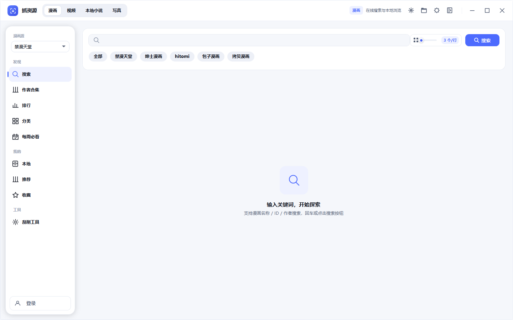
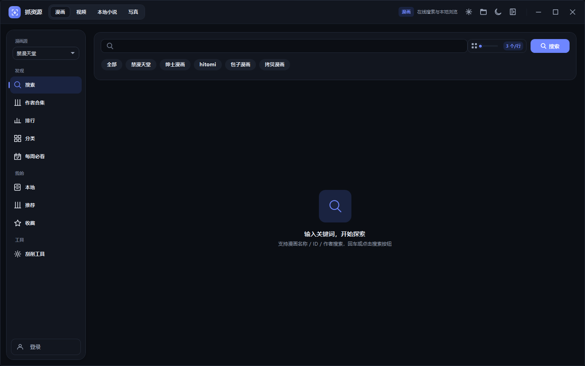

# 抓资源 ResourceGrab

<p align="center">
  
</p>

<p align="center">
  多源漫画 / 在线视频资源下载器与本地媒体库，基于 .NET 10 / WPF 的 Windows 桌面应用。
</p>

<p align="center">
  <sub>界面采用自研的 <a href="docs/DSO-UI.md">DSO UI</a> 设计系统：中性画布 + 单一强调色 + 发丝描边，深浅双主题。</sub>
</p>





支持禁漫天堂、拷贝漫画、包子漫画等多个内容源的搜索与下载，内置下载引擎、本地漫画库、视频库与小说阅读器。

## 内容源

| 源 | 类型 | 说明 |
| --- | --- | --- |
| 禁漫天堂（jm） | 漫画 | 关键词 / JM 号搜索、收藏夹同步、排行、分类、周榜 |
| 拷贝漫画（copymanga） | 漫画 | 搜索、分类浏览 |
| 包子漫画（baozimh） | 漫画 | 搜索、分类浏览 |
| hitomi | 漫画 | 搜索、热门排行 |
| wnacg | 漫画 | 搜索、日 / 周 / 月 / 年排行 |
| MissAV | 视频 | 在线搜索，解析 m3u8 直链，调用系统默认播放器播放 |
| 西瓜短剧（xigua） | 短剧 | 推荐 / 最新 / 四个频道 / 榜单 / 搜索，内置播放器选集连播，可整剧下载离线观看 |
| 爱丽丝书屋（alicesw） | 小说 | 在线搜索、书籍详情、章节目录、在线分章阅读、整本导出 TXT；本地已有则优先用本地数据 |

界面顶部下拉切换当前源，导航与页面按源能力自动适配；聚合搜索可同时查询多个源。

### 在线小说

「小说」一级下除本地索引外新增**在线书库**（爱丽丝书屋，域名 `alicesw.com` / `alicesw.tw` 自动轮换）：

- **找书**：书名 / 作者 / 标签三种搜索，站点分页；书卡 3:4 竖版，右上角是连载状态
- **分类 / 排行**：分类页按站点分类浏览（最近更新 / 字数最多 / 人气最高三种排序），排行页跟站点的日 / 周 / 月 / 总榜；两者共用同一张表格与分页
- **本地优先**：书名规范化后与本地索引全等 → 卡片挂「✓ 本地」，详情页改用本地文件与本地章节，主按钮直接读本地；只是子串关系则标「可能有本地」，不自动接管
- **书架**：详情页「加入书架」，书架页右键移除；读过的章自动记进度（`config\novel-shelf.json`），与本地索引互不写入
- **阅读**：沿用同一个阅读器（排版 / 背景 / 字号 / 进度完全一致），顶部多出「上一章 / 下一章 / 目录」；目录抽屉只覆盖正文区，不挡翻页条
- **阅读历史**：本地书与在线书共用一份记录（`config\novel-history.json`），按"本地 / 在线"标注；在线按章记录、展示时按书聚合，点一条直接续到上次那章（本地书续到上次页码）
- **缓存**：读过的章自动落盘到 `config\novel-cache\{源}\{书}\{章}.txt`，断网可读；内存里另有一层，切章不重新请求
- **导出 TXT**：详情页一键整本导出到 `config\小说导出\书名.txt`，之后由本地索引 / 书架接管；本地已存在同名文件时**覆盖**并明确提示
- **本地封面**：默认**离线生成**——按书名哈希出一张稳定的渐变书封（同书同色），不联网也有图；开着在线书库时再按书名去刮真封面（规范化全等才采纳），下载后统一转 jpg 存 `config\novel-covers\`，刮到就替换生成图。后台单线程慢速滴灌，只处理当前页的 40 本，查不到的书 7 天内不再重试
- **开关与代理**：「设置 → 小说」里可开关整组入口、填专用代理；没有 18+ 弹窗，进「在线书库」直接打开
- **标签可点**：详情页的标签点一下就跳——命中站点分类名（玄幻/都市…）进分类页，自由标签（群像/江湖…）按标签搜索
- **页面保持**：切到漫画/视频再切回「小说」，回到的是离开时那一页（详情页、阅读器也不会退回列表），左栏选中项跟着一起回来

### 短剧

「短剧」是独立的一级类型（与漫画/视频/小说/写真并列），单源接入：

- **浏览**：推荐、最近上新、榜单（热播/推荐/潜力 TOP20）、成人短剧/成人漫剧/AI魔改/西瓜原创四个频道、关键词搜索；
- **播放**：内置 Flyleaf 播放器，右侧选集面板点哪集播哪集；播放地址为站点签名短链，**每次播放实时换取**（约 2 小时过期）；
- **下载**：详情页「下载」可下本集 / 未下载的集 / 全剧，经 FFmpeg 直存 mp4（`-c copy` 不转码），一部剧一个文件夹，含 `drama.json` 元数据与封面；
- **下载队列**：短剧任务和视频任务一起显示在「下载」页（标题是「剧名 · 第N集」，副标题标「短剧」），可取消、完成后可打开所在剧集文件夹；左栏「本地」只管**已下载完**的剧集（离线播放、删除走回收站）；
- **线路自愈**：站点域名会轮换，线路卡点「⟳」会读取官方发布页（`/go-home/`）自动换线；也可在「设置 → 短剧」里手填线路。
- **封面**：站点把封面加密后放 CDN（AES-128-CBC，密钥在页面 `crypto-worker.js` 里），程序下载后**本地解密**再按剧集 id 缓存到 `config\drama-covers\`；解密失败才回落到渐变色 + 剧名首字。
- **竖屏适配**：播放器会读视频实际宽高比，竖屏（如 720×1280）自动把播放框收成手机比例并居中，横屏则铺满整列，不再出现"竖屏片塞进宽框、两侧全黑边"。
- **导入本地短剧**：本地页「导入本地短剧」选一个根目录（每部剧一个子文件夹），程序按目录名/文件名猜剧名与集号 → 去站点搜同名剧 → 补上简介、评分、标签、解密封面，写 `drama.json`/`poster.jpg` 并登记进本地库。**视频文件不移动、不复制、不重命名**；匹配不到会如实报告，不做强行关联。

## 下载引擎

- 多线程下载：最多同时获取 10 个章节图片列表、并行下载 3 个章节、40 张图片
- 断点续传：已存在的图片自动跳过，完整章节直接跳过，中断后无需从头开始
- 图片重组：禁漫分块乱序图片自动还原拼接；jpg / png / webp 输出格式可选
- 实时进度：全局进度条、每章节进度、实时速度

## 本地媒体库

- **漫画库**：管理多个本地目录，封面墙离线浏览（名字 / 标签），一键打开所在文件夹
- **中文名补全**：优先从目录名提取中文片段；纯外文标题可配置 OpenAI 兼容翻译接口（OpenAI / DeepSeek / 通义等）自动补齐并缓存
- **视频库**：本地视频的收藏 / 评分 / 标签 / 演员 / 系列 / 导演等多维管理与筛选；FFmpeg 自动截帧生成缩略图（未安装 FFmpeg 时降级为系统 Shell 缩略图）
- **小说阅读**：内置阅读器，阅读进度、历史与排版偏好独立保存

其他体验：保存账号密码后启动自动登录（DPAPI 加密）、接口域名失效自动轮换冷却、卡片分格大小统一调节并随窗口宽度自适应。

## 界面与设计系统

UI 基于自研的 **DSO UI**（见 [docs/DSO-UI.md](docs/DSO-UI.md)），核心约定：

- **一个强调色**：全局只有 `PrimaryBrush`（靛蓝 #4D6BFE）表达选中与主操作，其余用中性灰阶分层
- **发丝描边优先**：1px 描边 + 极轻阴影，不用整块实心高亮和发光渐变
- **状态用填充**：筛选药丸开启=中性填充，关闭=透明弱化；导航选中=8% 强调底 + 3px 指示条
- **深浅同构**：`Colors.xaml` / `DarkColors.xaml` 键名一致，切换只换字典，不动视图 XAML
- **令牌驱动**：圆角、间距、字号集中在 `Themes/Tokens.xaml`

应用图标的取景角标 + 下箭头与顶栏品牌块同构，由 `resources/icon/gen.py` 从代码生成多尺寸 ICO。

## 技术栈

- .NET 10 / C#，纯 WPF（XAML），无 WebView2 依赖
- `ResourceGrab.Core`：内容源适配（签名 / 解密 / HTML 解析）、下载引擎、图片重组、本地库服务
- `ResourceGrab.App`：WPF 界面层
- 主要依赖：AngleSharp、Polly、SixLabors.ImageSharp、Microsoft.Extensions.DependencyInjection、FlyleafLib（视频播放）

## 构建与发布

环境：**.NET 10 SDK**（构建）/ **.NET 10 Desktop Runtime**（运行框架依赖版）。

```powershell
# 还原并构建 Release
dotnet build ResourceGrab.slnx -c Release
```

也可以直接双击 `build-release.bat` 一键编译。

### 发布单文件（win-x64，框架依赖）

```powershell
.\publish.ps1
```

产物在 `bin\Release\`，结构固定：

| 路径 | 说明 |
| --- | --- |
| `ResourceGrab.App.exe` | 单文件主程序（约 35 MB，内含全部托管依赖） |
| `ffmpeg\` | FFmpeg 9.0 共享库 + `ffmpeg.exe` / `ffprobe.exe`（约 180 MB） |

两点必须注意：

- **`ffmpeg\` 目录要和 exe 一起分发**。Flyleaf 按「exe 同级 `ffmpeg\` 目录中存在 `avformat-*.dll`」定位原生库，只拷 exe 会退回「找不到 FFmpeg 共享库」，在线视频无法播放。
- 首次发布会从 GitHub 下载约 70 MB 的 FFmpeg 压缩包，已缓存在 `%TEMP%\flyleaf-ffmpeg-shared.zip`，重复发布不会重新下载；网络不通时可用 `-Proxy` 指定代理。

目标机器需安装 .NET 10 Desktop Runtime：

```powershell
winget install Microsoft.DotNet.DesktopRuntime.10
```

### 发布免安装自包含单文件（推荐分发）

```powershell
.\publish-standalone.ps1
```

产物在 `bin\release-standalone\`：

| 路径 | 说明 |
| --- | --- |
| `ResourceGrab.App.exe` | 自包含单文件（**约 76 MB**，自带 .NET 10 运行时，目标机无需安装任何依赖） |
| `ffmpeg\` | FFmpeg 9.0 共享库 + `ffmpeg.exe` / `ffprobe.exe`（约 180 MB，**必须和 exe 一起分发**） |
| `config\` | 首次运行自动生成（配置、日志、短剧下载/封面缓存） |

想要"连 ffmpeg 都塞进一个文件"也可以做（把 180 MB 原生库内嵌、首次启动解包到 `config\ffmpeg\`，产物约 300 MB），
代价是首次启动多等 3–5 秒；当前**按目录随行**，和 `config\` 一样属于数据目录。

### 发布免安装自包含版（手写命令）

```powershell
dotnet publish src/ResourceGrab.App -c Release -r win-x64 --self-contained true -p:PublishSingleFile=true -o BIN\release
```

自包含版不依赖目标机的 .NET 运行时，但同样需要把 `ffmpeg\` 目录放在 exe 旁边。

## 快速上手

1. 启动后在顶部选择内容源；需要账号功能（如禁漫收藏夹）的先点击「账号登录」
2. 搜索关键词或 JM 号，点击卡片进入章节详情，勾选章节（拖动框选 / Ctrl 多选 / 右键菜单）后一键下载
3. 下载完成后从导航栏进入「本地」浏览，`管理路径…` 可增删扫描目录
4. 视频库首次使用时添加本地根目录，程序会自动扫描并生成缩略图

## 数据与配置

程序为便携式设计：数据保存在 exe 同级的 `config\` 目录，绿色携带不写注册表。

| 文件 / 目录 | 用途 |
| --- | --- |
| `config.json` | 全局配置（账号、下载参数、接口域名、翻译等） |
| `download-history.json` | 下载历史 |
| `video-library.json` / `video-folders.json` | 视频库数据与根目录 |
| `短剧下载\` | 短剧本体：每部剧一个文件夹（mp4 + `drama.json` + `poster.jpg`） |
| `drama-covers\` | 解密后的短剧封面缓存（按剧集 id 命名，删掉会自动重新生成） |
| `drama-imports.json` | 导入的本地短剧目录登记（视频仍在用户原位置） |
| `novel-*.json` | 小说索引、阅读进度与排版设置 |
| `novel-cache\` | 在线小说章节缓存（`{源}\{书}\{章}.txt`，读过即缓存，可删） |
| `novel-shelf.json` | 在线书架（收藏与读到第几章） |
| `小说导出\` | 在线小说整本导出的 txt |
| `logs\` | 运行日志 |

安全说明：配置文件中的用户名、密码和翻译 API key 在 Windows 上使用 DPAPI（当前用户作用域）加密存储，旧明文配置会在首次启动时自动迁移为加密格式。

**短剧下载目录**：默认 `config\短剧下载`，可在「设置 → 短剧」里改到其它磁盘（短剧体积大，一部 6 集剧约 300 MB）。对应 `config.json` 的 `shortDrama.downloadDir`，留空即用默认目录：

```json
"shortDrama": {
  "downloadDir": "D:\\短剧",
  "baseUrl": "",
  "downloadConcurrency": 2
}
```

**接口域名轮换**：禁漫 API 域名失效时（登录 / 搜索报 404 等），程序自动在域名列表中轮换，失效域名临时冷却跳过。可在 `config.json` 中自定义域名列表，无需重新编译：

```json
"apiDomains": ["www.cdngwc.cc", "www.cdngwc.net"]
```

**标题翻译**：对缺失中文名的本地漫画，可在 `config.json` 中配置 OpenAI 兼容接口自动翻译，结果缓存到 `local-library-cache.json` 并写回 `album.json`：

```json
"titleTranslate": {
  "enabled": true,
  "baseUrl": "https://api.deepseek.com/v1",
  "apiKey": "sk-xxx",
  "model": "deepseek-chat"
}
```

## UI 架构规则（贡献者必读）

新增界面代码必须遵循以下规则，完整说明见 `docs/UI统一重构合并执行计划.md` 与 `docs/DSO-UI.md`：

- **新页面必须走路由**：经 `ShellNavigator` 注册（`Shell/Routes/`），禁止直接给 `PageHost.Content` 赋值。
- **新列表必须用统一结果区**：优先复用 `MediaResultHost` / `StateHostControl` + `VirtualizedCardGrid`，禁止手写 Loading/Empty/Error 面板逐个切 `Visibility`。
- **新卡片必须继承 `MediaCardViewModel`**：经 `MediaCardAdapters` 适配，由 `MediaCard` 按 `MediaVisualKind` 渲染，不复制整张卡片 XAML。
- **新筛选必须实现 `IFilterPanel`**：挂到 `SidebarHost`，事件收敛到 `FilterSelection`。
- **新图标必须用矢量资源**：`Themes/Icons.xaml` 中的命名 Path，禁止 emoji 表达功能图标。
- **视觉值必须走 token**：圆角/间距/字号/侧栏宽度引用 `Themes/Tokens.xaml`，颜色只用 `Colors.xaml` 中已有的语义键，视图 XAML 不写硬编码颜色与 `CornerRadius`。

## 免责声明

本工具仅作学习、研究、交流使用，请勿用于任何商业用途；使用本工具产生的一切风险由用户自行承担，与开发者无关。
