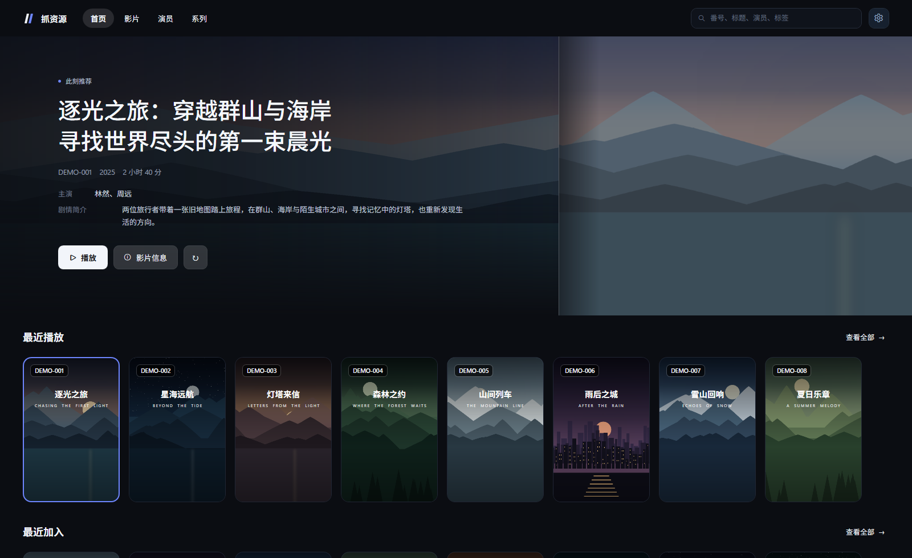

# 首页原型（映库风格 Hero + 卡片墙）

独立可运行的 WPF 原型，用来验证「大图 Hero + 双栏剧照 + 横向海报卡片」这套首页视觉在
当前技术栈（.NET 10 / WPF）上的还原度。**不依赖主工程**，也不改动 `src/` 任何代码。



## 运行

```powershell
dotnet run --project prototype/YingkuHome
# 直接定位到第 6 个条目（验证 Hero 切换与卡片选中）
dotnet run --project prototype/YingkuHome -- 5
```

- 窗口 1600×980，无系统边框；`Esc` 关闭，顶部空白处按住可拖动。
- 鼠标滚轮在卡片行上 → 横向滚动；点卡片 → Hero 淡入切换 + 选中环。

## 目录

```
prototype/
  gen_art.py                 演示素材生成器（Pillow，扁平插画风）
  YingkuHome/
    App.xaml                 资源字典入口
    MainWindow.xaml          顶栏 + 页面骨架 + 两个卡片行
    Controls/HeroBanner.*    Hero：背景交叉淡入 / 左侧文案 / 右侧剧照
    Controls/MediaCard.*     海报卡片：徽标 / 片名 / 英文副标题 / 悬停 / 选中
    Themes/Theme.xaml        颜色、渐变遮罩、导航药丸、三个按钮样式
    DemoData.cs              12 条演示数据（字段与 VideoFolder 对齐）
    Assets/                  poster_XX（2:3）/ backdrop_XX（1600×520）/ still_XX
```

## 和真实数据的对应关系

| 原型 | ResourceGrab 现有字段 | 说明 |
| --- | --- | --- |
| `DemoItem.Poster` | `VideoFolder.PosterPath` / `CoverPath` | 2:3 封面，卡片用 |
| `DemoItem.Still` | `VideoFolder.PreviewImages[0]` | Hero 右侧大图，缺省回退封面 |
| `DemoItem.Backdrop` | **暂无** | 需要新增；回退顺序见下 |
| `Code` / `Title` | 番号 / `Name` | |
| `Subtitle` | 暂无 | 英文名/罗马音，可留空 |
| `Actors` / `Description` | `Actors` / `Description` | |

Hero 横图的三级回退（真实数据接入时用）：

1. 有剧照 → 取第一张，居中裁 16:9；
2. 无剧照 → `VideoThumbnailService` 从视频 30% 位置抽帧；
3. 都没有 → 封面高斯模糊 + 放大 + 压暗当氛围底。

## 实现要点（移植时照抄这几条即可）

- **圆角裁图**：用 `Border.Background = ImageBrush`，`Border.CornerRadius` 会自动裁剪；
  不要 `Image` 再套 `Clip`，边缘会有锯齿。
- **字间距**：WPF 没有 `letter-spacing`。原型用「字符间插入 thin space（U+2009）」模拟，
  见 `MediaCard.LetterSpaced`。英文副标题必须这么做，否则没有参考图那种排版感。
- **大图性能**：所有 `BitmapImage` 都设 `DecodePixelWidth`（卡片 480 / 剧照 1000 / 背景 1600）
  并 `Freeze()`；静态层加 `CacheMode="BitmapCache"`。
- **别用 `DropShadowEffect`**：软件渲染，卡片一多就掉帧。原型用 1px 描边 + 悬停环替代。
- **交叉淡入**：Hero 放两张叠起来的 `Image`，切换时同时动画 `Opacity`，避免黑闪。
- **Hero 不能放视频**：如果以后要「视频当 Hero 背景」，Flyleaf 是 DComp 上屏，
  文字层要放在 WPF 侧并用 `Panel.ZIndex` 保证覆盖（现网已在小窗里验证过可行）。

## 移植到主工程

1. 把 `Controls/HeroBanner`、`Controls/MediaCard` 拷到 `ResourceGrab.App/Controls/`，
   命名空间改成 `ResourceGrab.App.Controls`。
2. 把 `Themes/Theme.xaml` 里的颜色/渐变/按钮样式并进 `DarkColors.xaml` + `Core.Controls.xaml`，
   `PrimaryBrush` 之类的语义键直接复用现有 DSO 令牌（原型里为独立运行做了复制）。
3. 在 `VideoView` 增加 `video.home` 视图：`HeroBanner.Item = 选中项`，
   两个 `ItemsControl` 分别绑「最近播放 / 最近加入」，点击回调走现有 `SelectVideo`。

## 已知未做

- 没有最小化/最大化/关闭按钮（`WindowChrome` 只开了拖拽和缩放）。
- 没有做窄窗口自适应：参考图是宽屏布局，<1280 需要把右侧剧照降级为背景。
- 素材是脚本生成的演示插画，真实封面信息密度更高，卡片上的压字可能需要改成「标题在下」。
